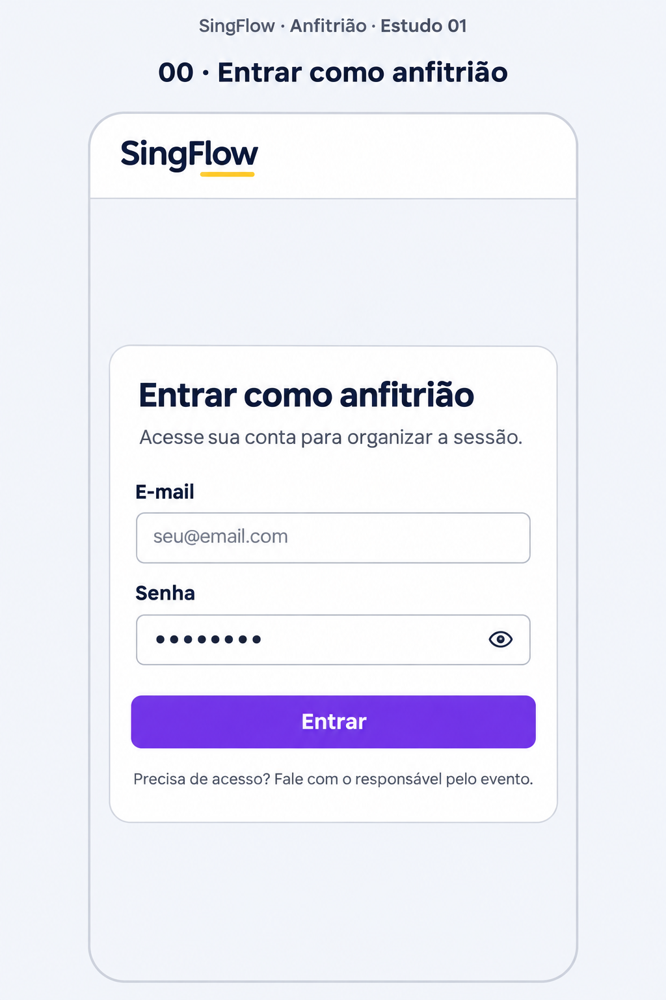
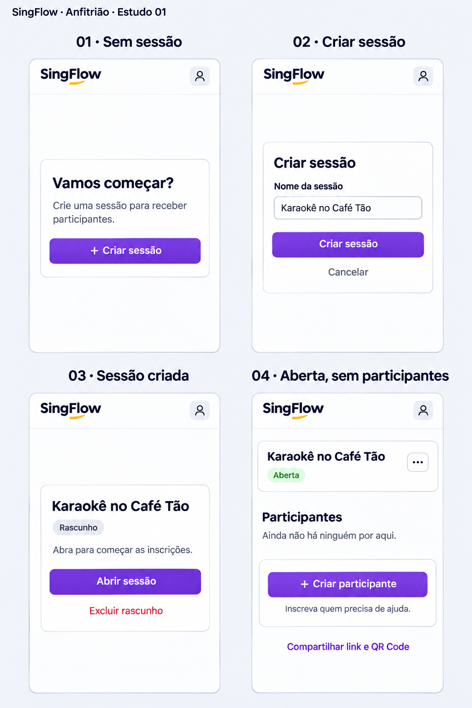
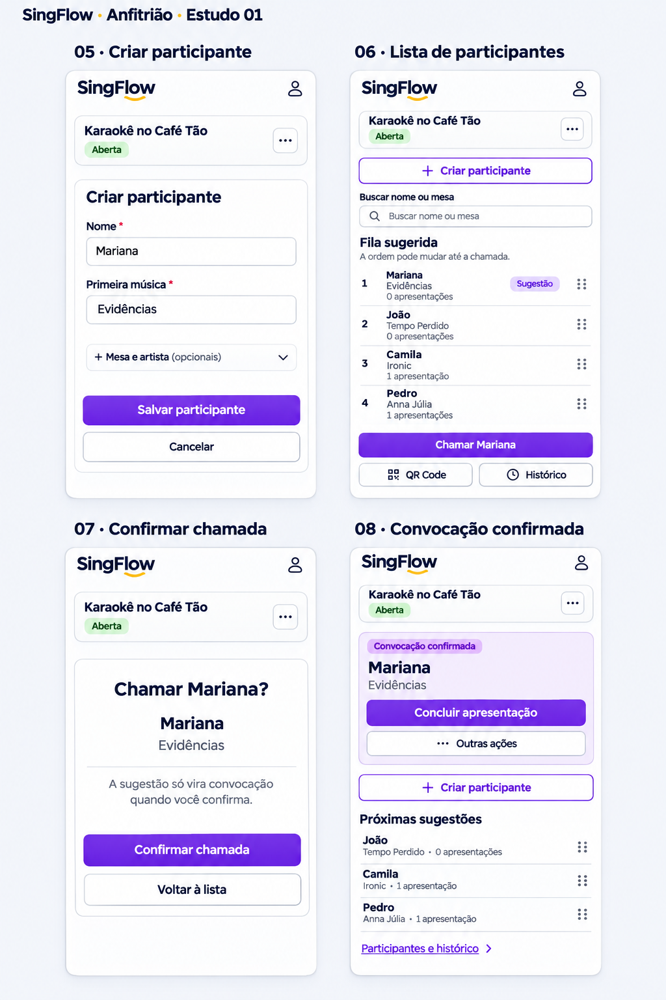
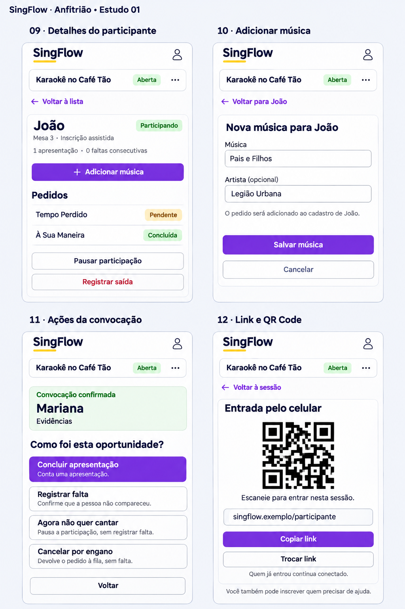
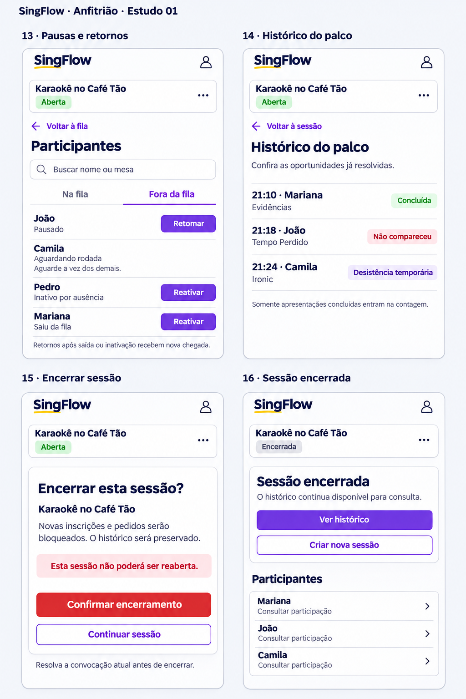

# Painel do anfitrião — desenho aprovado

Aprovado pelo responsável em 10/11/2026: “Tá ótimo, podemos fechar assim!”. As 17 telas, de 00 a 16, formam a referência visual para a futura implementação. O primeiro incremento Angular foi autorizado em 10/11/2026: base visual, login e sessões. Entrega e limites em [Incremento 01](host-redesign-increment-01.md). As demais etapas dependem de autorização própria.

## Direção visual

Priorizar navegador de celular, com adaptação para telas maiores. Header simples SingFlow, cartão compacto da sessão e lista de participantes com ações claras. Identidade: azul-marinho #0B1E3F, roxo #7C3AED, amarelo #FBBF24, fonte Manrope e superfícies claras.

Sem sessão aberta, apresentar um cartão central para criação e abertura. Com sessão aberta e vazia, destacar a inscrição assistida. Com participantes, colocar “Criar participante” em toda a largura acima da busca e da lista. A mudança de conteúdo do cartão deve respeitar a preferência por movimento reduzido.

## Telas numeradas

| Tela | Fluxo |
| --- | --- |
| 00 | Login do anfitrião |
| 01 | Sem sessão |
| 02 | Criar sessão |
| 03 | Sessão criada, ainda não aberta |
| 04 | Sessão aberta, sem participantes |
| 05 | Criar participante com primeira música |
| 06 | Lista de participantes e sugestões |
| 07 | Confirmar chamada |
| 08 | Convocação confirmada |
| 09 | Detalhes do participante |
| 10 | Adicionar música ao mesmo participante |
| 11 | Ações da convocação |
| 12 | Compartilhar link e QR Code |
| 13 | Pausas, saídas e retornos |
| 14 | Histórico de palco |
| 15 | Confirmar encerramento da sessão |
| 16 | Sessão encerrada |

## Referências aprovadas

As imagens são mockups; textos, dados, URLs e QR Codes são ilustrativos.

## Regras preservadas e detalhamento pendente

- Sugestão e convocação confirmada permanecem distintas; apenas uma convocação ativa. Somente conclusão contabiliza apresentação.
- Preservar inscrição assistida, múltiplos pedidos no mesmo cadastro, faltas, pausas, saída e retorno, compartilhamento e rotação do link e histórico.
- Encerramento exige resolver a convocação ativa e mantém o histórico; sessão encerrada não reabre.
- Exclusão de rascunho e reordenação pelos pontos laterais são propostas visuais sem capacidade correspondente no backend atual. Antes de implementar, revisar regras de retenção, prioridade, permissões, concorrência e auditoria. Oferecer alternativa acessível ao arraste; convocação confirmada não deve ser reordenada.
- Detalhar seleção de sessões anteriores, saída da conta, confirmações, validação, carregamento, erros e conexão instável durante a implementação.
- Verificar teclado, foco, leitores de tela, contraste, alvos de toque e responsividade na interface real. A aprovação das imagens não comprova acessibilidade.

## Próximas etapas

Os desenhos de participante e músico foram revisados e aprovados na conversa. O [incremento 01](host-redesign-increment-01.md) recebeu aceite manual. Concluir o aceite do [incremento 02](host-redesign-increment-02.md), de participantes e palco, e autorizar os próximos incrementos Angular, com regressão das funcionalidades existentes. Hospedagem permanece adiada.
