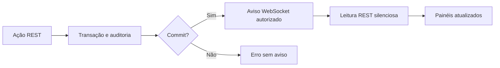

# WebSocket: fila e palco em tempo real

Revisão de 18/11/2026, branch `feature/websocket`. Estado: implementação local autorizada, em validação. Nenhuma publicação ou alteração AWS realizada. Repositório deve ser tornado privado depois deste incremento, com adaptação prévia da autenticação do CodeBuild.

## Recorte

Primeiro incremento: anfitrião, participante e músico; fila, pedidos, participantes, convocação/resposta/conclusão, pausa/retorno, encerramento e concessão/revogação de acesso do músico. Preservar layouts, ordem e regras atuais, inclusive a conclusão pelo anfitrião mesmo sem o participante confirmar a ida.

Notificações de sistema com app fechado (Web Push), sincronização do catálogo e acompanhamento do admin ficam para incrementos seguintes. O polling dessas duas áreas administrativas permanece nesta etapa; não prometer remoção global de consultas periódicas.

## Contrato implementado

REST continua responsável por ações e snapshots autorizados. WebSocket nativo do navegador recebe apenas avisos tipados (`ready`, `changed`, `ended`) no contexto autorizado; não recebe comandos de convocação, ordenação ou alteração de pedidos. Não transmitir nomes, músicas, contato, credenciais ou lista de outros participantes pelo canal do participante.

Fluxo: ação REST → transação e auditoria → commit → aviso de alteração → atualização silenciosa dos dados afetados. Uma transação que falhe não gera aviso. Agrupar eventos próximos da mesma sessão e consolidar leituras; não fazer uma consulta para cada registro de auditoria. Evitar duplicação entre atualização local da ação e aviso recebido.

Usar o suporte WebSocket do Spring no backend e serviço Angular compartilhado no frontend. Para este escopo, JSON simples evita incluir STOMP/SockJS e um broker externo. Não adicionar Redis, RabbitMQ ou outro serviço AWS. Registro de conexões e notificações em memória é adequado à instância única atual: reinício encerra conexões e a recuperação vem da leitura REST ao reconectar. Múltiplas instâncias exigirão rever a distribuição dos eventos.

O estado do banco continua sendo a fonte de verdade. Avisos podem ser agrupados ou perdidos durante desconexão; não são um histórico durável nem devem atualizar a posição da fila por incrementos locais.

## Autenticação e isolamento

A inspeção encontrou:

- Anfitrião, músico e admin usam sessão HTTP autenticada, com validação do estado da conta.
- Participante usa `SF_PARTICIPANT`, HttpOnly, com caminho `/api/participation/{session}`. Não ampliar o caminho desse cookie para resolver o WebSocket.
- Concessão de acesso do músico e resgate do participante podem revogar acessos existentes.

Autenticação inicial por autorização curta, de uso único, emitida por POST protegido por CSRF e pelas permissões existentes. Entregar a autorização no primeiro frame da conexão, sem tokens na URL. Vincular emissão/consumo à sessão HTTP e ao contexto autorizado, com validade curta, limite de pendências e tempo máximo para autenticar um socket. No participante, emissão e conexão ficam sob o caminho da própria sessão, compatível com o cookie atual.

Não aceitar inscrições livres em qualquer sessão pelo cliente. O servidor determina os contextos e destinatários permitidos. Verificar Origin com origens explícitas e respeitar o host público configurado; não habilitar origem `*`. Autenticação de conexão não dispensa tratamento de revogação, logout, expiração, troca de celular e encerramento. Esses eventos devem remover/encerrar o contexto afetado antes de futuras entregas. Revalidar acesso antes de entregas quando necessário, agrupando verificações; heartbeat não consulta o banco.

| Painel | Alterações recebidas |
| --- | --- |
| Anfitrião | Sessões próprias/autorizadas, participantes, pedidos e palco |
| Participante | Invalidação do próprio estado e posição na sessão, sem dados privados de terceiros |
| Músico | Sessões às quais tem acesso, concessão/revogação, fila, palco e tom |

## Cliente e recuperação

Uma conexão por contexto/painel em cada aba, gerenciada pelo serviço compartilhado. Encerrar conexões e timers ao sair do contexto. Conectar/assinar antes da leitura de recuperação para evitar uma janela sem atualização.

Sem polling frequente quando a conexão estiver saudável. Reconexão com atraso progressivo e aleatoriedade, sem loops imediatos. Ao reconectar ou voltar ao app, buscar estado atual. Durante indisponibilidade persistente, usar atualização de contingência moderada (30 segundos, somente com tela visível), preservando o botão Atualizar. Suspender tentativas inúteis após acesso revogado ou encerrado.

Heartbeat e controle de conexões lentas em memória, com limites de mensagem, buffer e quantidade de conexões. Envio não deve manter transação/bloqueio do banco nem atrasar a ação REST por um cliente lento. Para mensagens que cheguem enquanto há modal de confirmação, edição ou arraste, guardar a necessidade de atualização e aplicá-la ao liberar a interação, sem perder formulário ou sobrescrever estado novo com resposta antiga.

Reconexão e consultas de contingência não exibem loading global nem toast a cada atualização. Erros da leitura seguem o tratamento existente do painel. Avisos centrais já existentes do participante continuam reagindo ao snapshot: na fila, próximo, chamado e cantando. Web Push e autorização de notificações do celular não entram neste incremento.

## Eventos e organização do backend

Criar módulo `realtime` com transporte, autorização e endpoints próprios, consumindo interfaces públicas dos módulos existentes. Aproveitar a auditoria/eventos de sessão existentes como fonte de mudanças confirmadas, sem criar dependência circular entre realtime e regras de negócio. Separar sinal de mudança, autorização do destinatário e envio ao socket. Não escrever no banco em listener AFTER_COMMIT sem transação explícita; o transporte não precisa dessa escrita.

As ações devem continuar corretas mesmo se a publicação de um aviso falhar. O cliente recupera o snapshot após reconexão; mensagens não substituem idempotência nem auditoria dos comandos REST. Sem migration prevista para o primeiro transporte; rever somente se a inspeção detalhada demonstrar necessidade de estado durável.

## Proxies e ambientes

Preparar encaminhamento Upgrade/Connection no Nginx do frontend e suporte WebSocket no proxy Angular local. Avaliar o proxy Node existente para não perder compatibilidade com execução independente; encaminhar apenas os caminhos autorizados, sem URLs arbitrárias. Usar o mesmo domínio do app, `ws` no HTTP local e `wss` no HTTPS.

Revisar o caminho público pelo CloudFront antes de um deploy futuro (encaminhamento dos headers de WebSocket, cookies e ausência de cache). Não modificar a AWS, abrir portas, gerar imagens ou publicar esta branch durante o desenvolvimento sem autorização específica.

## Validação essencial

- Autenticação/Origin/CSRF, ticket expirado/reutilizado, isolamento por sessão e por participante.
- Nenhum aviso após rollback; agrupamento de múltiplos sinais da mesma transação.
- Revogação do músico, encerramento da sessão, saída/retorno, resgate para outro aparelho, expiração/logout.
- Reconexão com recuperação, eventos durante leitura em andamento, mudanças durante modal/drag, ausência de polling frequente com conexão saudável.
- Fluxo crítico de convocação/resposta/conclusão, preservando a volta à fila após conclusão sem aceite.
- Handshake real com backend e PostgreSQL temporário, além de testes de frontend com transporte/API simulados e testes dos proxies.

Manter testes de segurança e concorrência do backend. Acrescentar à suíte crítica apenas os fluxos de transporte/recuperação indispensáveis, sem repetir todos os detalhes visuais nos dois viewports. O responsável continua iniciando frontend/backend/banco pela IDE.

## Referências

- [Spring WebSocket API](https://docs.spring.io/spring-framework/reference/web/websocket/server.html): origens permitidas e sincronização/limites de envio.
- [Spring Boot WebSockets](https://docs.spring.io/spring-boot/reference/messaging/websockets.html).
- [TransactionalEventListener](https://docs.spring.io/spring-framework/docs/current/javadoc-api/org/springframework/transaction/event/TransactionalEventListener.html): AFTER_COMMIT e limites de acesso transacional após o commit.

## Operação deste incremento

- Não há migration nova. O transporte e os tickets ficam em memória nesta instância.
- `SINGFLOW_PUBLIC_APP_URL` autoriza a origem pública; `SINGFLOW_REALTIME_ALLOWED_ORIGINS` aceita origens adicionais explícitas separadas por vírgula. Não usar `*`. No perfil local, os dois loopbacks na porta 4200 são adicionados. Para celular na rede, configurar a origem com o IP público local usado no navegador.
- O cookie do participante mantém o caminho restrito. O ticket de 30 segundos é emitido por POST protegido por CSRF e segue somente no primeiro frame, nunca na URL. Handshake sem autenticação expira em cinco segundos.
- Mudanças são agrupadas em lotes de 150 ms no servidor e leituras em 180 ms no navegador. Atualização fica adiada durante arraste ou confirmações. Heartbeat de 20 s não consulta banco. Queda provoca reconexão progressiva; fallback de dados a cada 30 s enquanto visível. Aba oculta suspende o canal; retorno refaz a leitura.
- Puxar para atualizar foi acrescentado ao viewport principal de anfitrião, participante e músico. O gesto não recarrega o documento, não atua em campos, itens arrastáveis ou scrollareas internas, e mostra “Puxe para atualizar” / “Solte para atualizar”. A alternativa manual permanece no menu para mouse, teclado e tecnologias assistivas. Conferir o gesto nativo no Safari/Chrome do aparelho.
- Os proxies Angular, Nginx e Node encaminham o upgrade. O Node aceita somente os caminhos de socket previstos e não aceita parâmetros na URL.
- Antes de publicar, revisar o encaminhamento WebSocket do caminho público de hospedagem. Múltiplas instâncias exigirão distribuição de eventos e tickets compartilhados; este incremento atende à instância única atual.

## Resultado das verificações locais — 18/11/2026

| Verificação | Resultado |
| --- | --- |
| Backend `verify` executado pelo responsável | 219 testes; 218 passaram e uma expectativa de código de fechamento no logout falhou |
| Repetição `RealtimeIntegrationTests` pelo responsável | BUILD SUCCESS após aceitar também o `1008` usado pelo Spring na invalidação da sessão HTTP; nenhuma regra de acesso foi relaxada |
| Tickets, hub e arquitetura sem banco | 5 testes aprovados |
| Frontend build de produção | Aprovado; avisos existentes de orçamento de CSS e dependências CommonJS do QR Code |
| Configuração, proxy Node e pacote de publicação | 20 testes aprovados, incluindo upgrade e restrição dos caminhos |
| Suíte crítica de interface | 32 execuções aprovadas em 36,3 s, API simulada |
| Conferência adicional de participante e recuperação | 4 execuções aprovadas; convocação/conclusão via canal, conexão estável, suspensão em aba oculta e fallback de dados |

O gesto automatizado foi exercitado no navegador; Safari/Chrome do celular e um ensaio integrado entre aparelhos aguardam a conferência do responsável. Reinício do backend continua sendo feito pela IDE. Sem commit, push, imagens ou deploy nesta etapa.

## Conclusão com letra aberta — 18/11/2026

Relato: conclusão pelo anfitrião demorou a aparecer no participante que já estava lendo a letra. O navegador recebeu o aviso e retornou rapidamente nos testes com letra carregada e com resposta de letra ainda pendente; não se confirmou bloqueio da tela pela letra.

Foi reproduzida outra causa possível: o agendador padrão compartilhado podia ficar ocupado pela sincronização do catálogo, que consulta Last.fm de forma síncrona. Nesse cenário, `flush` do WebSocket aguardava junto. `RealtimeSchedulingTests` reproduziu a espera antes da correção. O transporte passa a usar `realtimeScheduler`, separado do `taskScheduler` padrão do catálogo, com dois clocks para que heartbeat e envio de avisos não disputem uma única thread. O envio de dados continua no executor limitado existente, fora da transação. Não foram acrescentadas consultas, chamadas externas ou migrations.

`participant-lyrics.spec.ts` passou a receber a conclusão por WebSocket (em vez de simular o polling anterior), incluindo cancelamento de uma resposta de letra atrasada. O cenário com letra aberta entra no gate crítico mobile. A causa exata do atraso observado no aparelho depende da repetição após reiniciar o backend; não foi coletado um traço daquela execução.

A validação posterior à separação do agendador passou nos seis testes focados sem banco (hub, tickets, arquitetura e contenção). Os 12 cenários de letra passaram em mobile/desktop com API simulada. A repetição de `RealtimeIntegrationTests` e o ensaio do atraso no aparelho foram solicitados ao responsável; o gesto elástico já foi confirmado por ele no iOS e no Android.
